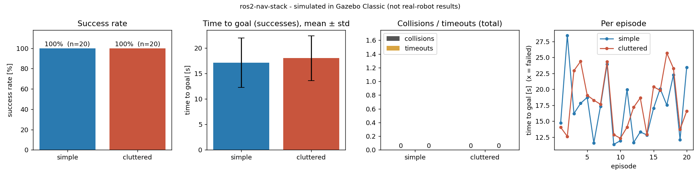

# ros2-nav-stack

A custom C++ navigation stack for ROS 2 **Humble** in **Gazebo Classic (gazebo11)**: 2D lidar perception, an **A\*** planner, and a **pure-pursuit** controller—all implemented from scratch, evaluated across **40 randomized, seeded episodes** (20 per world) by an automated episode runner with crash handling, telemetry recording, and failure mode analysis.

> **Simulated in Gazebo.** Evaluated in Gazebo Classic; hardware constraints are modeled in the URDF and controller limits.


*The GIF is a screen capture of one real episode (`scripts/record_gif.sh`): episode 1 of the cluttered benchmark environment, rendered headless under Xvfb with Mesa software GL.*

## What this is — and what it is not

**This is** a complete, lightweight C++ navigation stack written from scratch:

| Component | Function | Location |
|---|---|---|
| Perception | `/scan` → 2° resampling → obstacle clustering (`/obstacles`) and log-odds occupancy grid (`/costmap`) | `ros2_ws/src/perception` |
| Planner | 8-connected A\* on an inflated grid (0.30 m margin), replanning at 2 Hz, empty path for unreachable targets | `ros2_ws/src/navigation` |
| Controller | Pure pursuit path tracker, lookahead 0.6 m, velocity and curvature clamps | `ros2_ws/src/navigation` (algorithm) + `ros2_ws/src/control` (node) |
| Evaluation | Seeded episode runner, strict metric summarizer, failure classifier | `ros2_ws/src/evaluation`, `scripts/` |

**This is not**
* **Nav2** — Nav2 is **not used anywhere**. The primary motivation was implementing the perception, global planning, and trajectory tracking controllers directly from first principles.
* **SLAM or localization** — `/odom` uses ground-truth pose from Gazebo's differential drive plugin (`map` and `odom` coincide); the costmap is mapped online using known robot poses.
* **Physical hardware deployment** — Developed and tested in Gazebo Classic simulation.
* Dynamic obstacle tracking or camera-based vision (an RGB camera is defined in the URDF/TF for visualization, but perception is 2D lidar-driven).

## Benchmark Results

Evaluation across 40 randomized, seeded runs (from `results/summary.csv`):

| World | Episodes | Success Rate | Time to Goal [s] (mean ± std) | Path Length [m] (mean) | Collisions (total) | Timeouts | Mean RTF |
|---|---|---|---|---|---|---|---|
| simple | 20 | 100% (20/20) | 17.1 ± 4.8 | 7.57 | 0 | 0 | 1.00 |
| cluttered | 20 | 100% (20/20) | 18.0 ± 4.4 | 8.05 | 0 | 0 | 1.00 |

* **Success condition:** Robot center within 0.3 m of goal; time is simulation time.
* Detailed analysis, failure modes, parameter sweeps, and fault injection: **[FINDINGS.md](FINDINGS.md)**.
* Node rates, interfaces, and TF tree: **[ARCHITECTURE.md](ARCHITECTURE.md)**.
* Scope statement: **[SPEC.md](SPEC.md)**.



* **Execution duration:** 40 evaluation episodes ran across 14.3 minutes of wall-clock time (simulation physics capped at 1.0 real-time factor).
* **Test Environment:**

| Item | Specification |
|---|---|
| CPU | Intel(R) Xeon(R) Processor @ 2.10GHz (4 cores) |
| RAM | 16 GB |
| OS / Container | Ubuntu 22.04.5 LTS (Docker) |
| ROS Distro | Humble Hawksbill |
| Simulator | Gazebo Classic 11.10.2 |
| Compiler | g++ 11.4.0 (C++17) |

## System Architecture

```
 gzserver (headless) ── /scan (360 beams, 10 Hz) ──► obstacle_detector ── /costmap (OccupancyGrid, 2 Hz) ──► astar_planner ── /plan (Path, 2 Hz) ──► waypoint_follower
        ▲  ▲                                          └─ /obstacles (PoseArray)                                ▲ /goal_pose                                      │
        │  └──── /odom (ground truth) + TF odom→base_link ────────────────────────────────────────────────────┴───────────────────────────────────────────────────┤
        └──────────────────────────────────────────── /cmd_vel (Twist, 20 Hz, clamped) ◄──────────────────────────────────────────────────────────────────────────┘
 TF: map ─► odom ─► base_link ─► {laser, camera, wheels, casters}          all nodes synchronized on /clock (use_sim_time)
```

**Dynamic limits** (enforced in controller and URDF wheel joints; sourced from `ros2_ws/src/robot_description/config/robot_limits.yaml`):
|v| ≤ **0.50 m/s**, |ω| ≤ **1.20 rad/s**.

Full node/topic specifications and TF details: **[ARCHITECTURE.md](ARCHITECTURE.md)**.

## Quickstart & Reproduction

Run with Docker Compose:

```bash
# 1. Build the container
docker compose build

# 2. Build packages and run unit tests
docker compose run --rm ros2 bash -lc "colcon build --symlink-install && colcon test && colcon test-result --verbose"

# 3. Execute evaluation episodes and generate summary
docker compose run --rm ros2 bash -lc "ros2 run evaluation run_episodes --world simple --episodes 20 && ros2 run evaluation run_episodes --world cluttered --episodes 20 && python3 /workspace/ros2_ws/src/evaluation/scripts/summarize.py"
```

The metric summarizer can also be run locally on the host:
```bash
python3 ros2_ws/src/evaluation/scripts/summarize.py
```
*(Requires matplotlib; append `--no-png` to skip figure generation).*

Smoke and contract tests:
```bash
docker compose run --rm ros2 bash -lc "/workspace/scripts/check_tf.sh"
docker compose run --rm ros2 bash -lc "/workspace/scripts/check_frames.sh"
docker compose run --rm ros2 bash -lc "/workspace/scripts/check_launch_smoke.sh"
```

## System Verification Checks

| # | Property | Validation Check | Status |
|---|---|---|---|
| 1 | TF / topic / node audit after headless launch | `scripts/check_tf.sh` | PASS |
| 2 | Published frame IDs match URDF links (`laser`, not `laser_link`) | `scripts/check_frames.sh` | PASS |
| 3 | Perception: synthetic wall at 1.0 m → centroid within 0.1 m | `perception/test/test_obstacle_detector.cpp` | PASS |
| 4 | Planner: empty-map optimum, wall + gap, unreachable → empty path | `navigation/test/test_astar.cpp` | PASS |
| 5 | Controller: 0.5 m off-axis → < 0.1 m in 5 s, limits respected | `control/test/test_waypoint_follower.cpp` & `scripts/check_controller_gazebo.sh` | PASS |
| 6 | Seed reproducibility: identical seed ⇒ identical spawn pose | `evaluation/test/test_episode_sampler.cpp` & `scripts/check_repro.sh` | PASS |
| 7 | Summarizer: valid statistics, missing data fails hard | `evaluation/test/test_summarize.py` | PASS |
| 8 | Headless launch: `sim.launch.py` initializes all nodes in < 30 s | `scripts/check_launch_smoke.sh` | PASS |
| 9 | Crash handling: killed node logged and run proceeds | `scripts/check_crash_handling.sh` | PASS |
| 10 | Headless bringup acceptance check: all expected nodes responsive | `scripts/check_acceptance.sh` | PASS |

## Engineering Post-Mortems ("Things that broke")

Real engineering issues encountered during development and how they were solved:

### 1. Launch failure from redefining built-in xacro symbols
* **Symptom:** `ros2 launch bringup sim.launch.py` terminated abruptly with `Caught exception in launch ... executed command showed stderr output. Command: xacro .../diffbot.urdf.xacro`.
* **Cause:** Defined `<xacro:property name="pi">` in URDF. xacro already provides `pi` internally and outputs a warning to stderr, which the launch `Command` substitution treats as an exit error.
* **Fix:** Removed redundant property definition. **File:** `ros2_ws/src/robot_description/urdf/diffbot.urdf.xacro`.

### 2. `obstacle_detector` TF exception & message filter drops
* **Symptom:** Crashed with `terminate called after throwing an instance of 'tf2_ros::CreateTimerInterfaceException'`, followed by `Do not call canTransform or lookupTransform with a timeout unless you are using another thread…` at 10 Hz with an empty costmap.
* **Cause:** `tf2_ros::MessageFilter` handles asynchronous transform lookups; the underlying `Buffer` requires an active timer interface and must be serviced by a dedicated listener thread.
* **Fix:** Configured `setCreateTimerInterface(CreateTimerROS)` and standard self-spinning `TransformListener`. **File:** `ros2_ws/src/perception/src/obstacle_detector.cpp`.

### 3. ROS 2 CLI daemon discovery latency inside Docker
* **Symptom:** `ros2 topic list` missed active topics (`/costmap`, `/plan`), and `ros2 node list --no-daemon` periodically returned empty during automated checks while nodes were actively executing.
* **Cause:** Fast DDS discovery over containerized shared memory / loopback has brief latency before daemon cache warms up.
* **Fix:** Test scripts poll listings until a deadline with generous timeouts and verify graph topology with an rclpy probe. **Files:** `scripts/check_tf.sh`, `scripts/wait_for_nodes.py`.

### 4. Wall-clock timers vs. simulation-time synchronization
* **Symptom:** Drift between simulation time and node execution rates when physics real-time factor fluctuated.
* **Cause:** Nodes were initially instantiated using `create_wall_timer`, ignoring `/clock`.
* **Fix:** Replaced with `rclcpp::create_timer(this, get_clock(), ...)` to ensure all planners and controllers tick strictly in lockstep with simulation time. **Files:** `obstacle_detector.cpp`, `astar_planner.cpp`, `waypoint_follower.hpp`.

### 5. Headless Gazebo sensor rendering without GPU (Software GL / Xvfb)
* **Symptom:** Gazebo client / sensor visualization crashed when attempting to record simulation footage in headless Docker without a display.
* **Cause:** Headless Linux environments lack an active X server and hardware GPU context for OGRE rendering.
* **Fix:** Configured virtual framebuffers with Xvfb and Mesa LLVMpipe software rasterizer (`scripts/record_gif.sh`) to render simulation frames reliably headless. **File:** `scripts/record_gif.sh`.

### 6. World obstacle packing density constraints
* **Symptom:** World generator failed with `cluttered: could only place 31/40 obstacles` across 200,000 sampling iterations.
* **Cause:** 40 circular/rectangular obstacles with 1.0 m clearance and 1.0 m boundary spacing exceed physical packing limits of a 12 m × 12 m arena.
* **Fix:** Adjusted density to 30 obstacles with ≥ 0.9 m inter-obstacle clearance and ≥ 0.8 m wall spacing (minimum navigable corridor: 0.819 m). **File:** `worlds/gen_worlds.py`.

### 7. Refuting obstacle clearance hypotheses using bag telemetry
* **Symptom:** In cluttered episode 2, the robot approached within 0.18 m of an obstacle (body radius 0.16 m).
* **Cause (Hypothesis):** Suspected late lidar returns or controller tracking deviation.
* **Refutation:** Analyzed recorded rosbags (`scripts/analyze_first_seen.py`, `scripts/analyze_plan_vs_robot.py`): lidar first detected the obstacle 0.18 s prior to goal dispatch, and tracking error was < 0.058 m. Analysis proved the clearance reduction came from grid discretization on 0.1 m cells and start-bubble relaxation in A\*.
* **Mitigation:** Kept analysis tooling for diagnostic verification. **Files:** `scripts/analyze_first_seen.py`, `scripts/analyze_plan_vs_robot.py`.

### 8. Relative script resolution in CI workflows
* **Symptom:** GitHub Actions passed compilation and tests, but failed at smoke validation with `scripts/check_launch_smoke.sh: No such file or directory`.
* **Cause:** Container `working_dir` was `/workspace/ros2_ws`, making relative script paths resolve incorrectly.
* **Fix:** Specified absolute paths (`/workspace/scripts/...`) across all CI runner definitions. **File:** `.github/workflows/ci.yml`.

## Diagnostics and Failure Logs

* `results/crash_log.txt`: Contains backtraces if a node crashes during execution.
* `results/limits_report.txt`: Generated if RTF falls below 0.3 or an episode exceeds 3× mean completion time.
* `results/episode_diagnostics.csv`: Per-episode telemetry, trajectory coordinates, closest approach distances, and execution timestamps.

## Repository Layout

```
README.md  SPEC.md  FINDINGS.md  ARCHITECTURE.md
Dockerfile  docker-compose.yml  .github/workflows/{ci.yml,episodes.yml}
ros2_ws/src/{robot_description,perception,control,navigation,bringup,evaluation}
worlds/{simple.world,cluttered.world,empty.world,*.obstacles,gen_worlds.py,world_stats.json}
scripts/   check_*.sh (smoke/contract checks)  run_*.sh  failure_modes.py  analyze_*.py  record_gif.sh
results/   episodes.csv summary.csv summary.png hardware.json rosbag_manifest.json
media/run.gif
```
